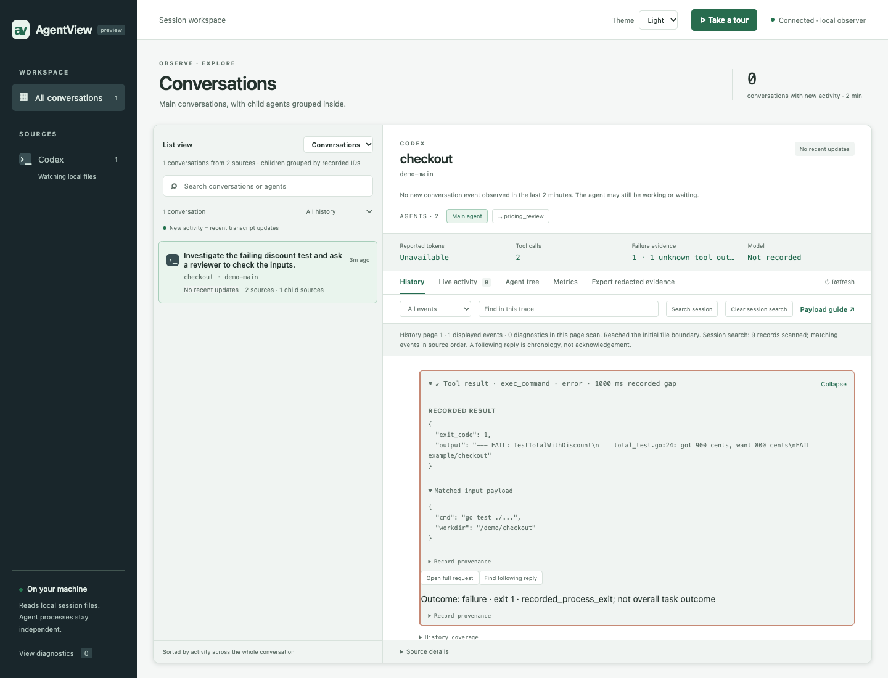

# AgentView

A local browser for investigating coding-agent sessions: inspect tool failures, follow delegated work, and trace each observation back to its source. Attach to existing Claude Code and Codex transcripts, including sessions that started before AgentView. No agent-side SDK or instrumentation is required for the supported file formats.

**Status: local browser preview.** Browse Claude Code and Codex sessions, navigate recorded agent relationships, inspect history or live activity, and examine available token and tool metrics. CLI inspection also supports experimental Copilot and Rovo adapters. There is no durable history or agent-control API.

AgentView is useful when a long transcript makes it hard to connect a command to its result, a child agent's work, or the parent's next reply. It suits developers debugging their own agent-assisted work and maintainers investigating supported transcript formats. Everything runs locally; AgentView reads files and leaves the agent processes independent.



*Bundled synthetic demo: inspect the failed command and its input without running an agent or making a model call.*

## What can I debug?

| Your question | Start here | Evidence you can inspect |
|---|---|---|
| “Did that test or tool call fail?” | History → Failures → Search session | Supported failure flags/exit codes, input payload, result and following reply |
| “Why was this child spawned?” | Agent tree → child → Inspect messages & provenance | Recorded spawn instructions/result, linked child trace and reply excerpts |
| “Which session is receiving updates?” | New activity (2 min) → Live activity | Newly observed messages and tool events, including child-source activity |
| “Why is the agent repeating work?” | Tools or Context changes → Search session | Repeated requests/results and supported compaction markers to investigate |
| “How do I report a confusing trace?” | Record provenance → Export redacted evidence | Source positions and structural evidence with payloads and paths omitted |

AgentView exposes recorded evidence. It cannot establish process liveness, whether a child reply was actually used, or overall task correctness. Missing records and unsupported formats remain gaps. See the [debugging walkthroughs](docs/debugging.md) for practical steps and how to interpret each result.

## Open the dashboard

From source on macOS or Linux, with Git, Make and Go 1.24+ installed (the module selects Go 1.26.10 automatically):

```sh
git clone https://github.com/shbhmrzd/agentview.git
cd agentview
make build
./bin/agentview serve --include-content
```

Open the complete local URL printed in the terminal. It contains a per-launch access token. The dashboard discovers `${CODEX_HOME:-$HOME/.codex}/sessions` and `${CLAUDE_CONFIG_DIR:-$HOME/.claude}/projects`. New sessions appear automatically.

`--include-content` lets you read messages and tool payloads locally; it is not redaction. Omit it for metadata only. AgentView does not upload your transcripts or run commands found in them.

Choose **New activity (2 min)** to find sessions with newly observed messages, tools, or turn events. A skippable first-visit tour explains the navigation; **Take a tour** reopens it later.

**Conversations** shows one row per main conversation and its related child sources, with request excerpts as titles when content is enabled. Child activity updates that conversation; separate chats in the same project stay separate. Use **List view → All sources** for individual files.

**Agent tree** groups recorded parent/child relationships with request and reply excerpts. **Payload guide** opens an interactive sample call/result. Use **Theme** in the top bar to switch between light and dark; your browser remembers the choice.

- Select a session, then an agent in its recorded family.
- **History** pages through the file’s initial boundary; **Live activity** follows newly observed records.
- **Metrics** shows available model, usage, tool counts, failure evidence, unknown outcomes, reported cost estimates, and paired timestamp gaps.
- Filter messages, tools, failures, communication, context changes, or turns; expand payloads and record provenance when needed.
- Search projects/session IDs, switch providers, or choose **All history** for older sources.

Use `--agent codex` or `--agent claude` to select one provider. For a custom root:

```sh
./bin/agentview serve --agent codex --dir /absolute/path/to/sessions --include-content
```

Without `--include-content`, the dashboard shows metadata only. Ctrl-C stops the local observer and leaves agents alone. File activity is not proof of a running process. Accuracy and billing cost stay unavailable without appropriate evidence. See the [dashboard guide](docs/dashboard.md) for metric semantics, privacy, limits, and coverage.

## Walk through a failed test

1. Select a conversation and the agent that ran the command, then open **History**.
2. Select **Failures** and click **Search session** to search beyond the displayed page. Searches cover the selected source; inspect a child's source separately when needed.
3. Expand the result and **Matched input payload**. Compare the actual arguments, output and recorded outcome. **Open full request** retrieves input beyond the carried excerpt; **Find result** returns to the result.
4. Use **Find following reply** to read what the assistant said next. Chronological proximity does not prove it used or understood the result.
5. Open **Record provenance** when you need the native record type, call ID or byte range. **Clear session search** returns to chronological history.

### Try it without an agent account

After building, run this instead of the normal `serve` command:

```sh
./bin/agentview serve --agent codex \
  --dir "$PWD/testdata/debugging-demo" \
  --include-content --listen 127.0.0.1:0
```

Open the printed URL, choose **All history**, and select **Investigate the failing discount test…**. The bundled example contains a failed test, a delegated reviewer, and the parent's follow-up. It reads only [synthetic files](testdata/debugging-demo/README.md); no commands execute and no model is called. Follow the [demo walkthrough](docs/debugging.md#try-the-demo) to inspect the failure and child task. The first-visit tour and **Payload guide** are also available.

## Run the experiment

Use Go on macOS or Linux. The module requires Go 1.24+ and selects Go 1.26.10 with Go’s automatic toolchain management. The older Go 1.22 linker can produce binaries rejected by recent macOS versions. Runtime code uses the Go standard library and embedded HTML/CSS/JavaScript; no frontend build or third-party runtime dependencies are needed. Node.js 20+ is required only for browser view-model tests.

```sh
go build -o bin/agentview ./cmd/agentview
./bin/agentview inspect --agent claude --file testdata/claude.synthetic.jsonl
./bin/agentview inspect --agent codex --file testdata/codex.synthetic.jsonl
./bin/agentview inspect --agent copilot --file testdata/copilot.synthetic.jsonl
./bin/agentview inspect --agent rovo --file testdata/rovo.synthetic.json
./bin/agentview adapters
```

All demo inputs are [original synthetic fixtures](testdata/README.md). No agent is started and no model is called. Terminals show compact text; pipes and redirected files receive JSONL. Choose explicitly with `--format text` or `--format jsonl`. Prompts, responses, and tool payloads are omitted by default.

| Adapter | Selected input | Validation level |
|---|---|---|
| `claude` | Native transcript JSONL | Fixture/process tests and native seed/resume checks |
| `codex` | Native rollout JSONL | Fixture/process tests and native seed/resume checks |
| `copilot` | Copilot CLI `events.jsonl` | Source-backed fixtures/process tests; native access blocked by account policy |
| `rovo` | Rovo Dev CLI `session_context.json` | Native request-history read plus source-backed fixtures/process tests; native model response failed |

Copilot and Rovo are experimental adapters. This does not advertise Copilot IDE/cloud or Rovo cloud agent support. See [provider format evidence](docs/provider-format-evidence.md).

To inspect a real source, explicitly supply its path:

```sh
./bin/agentview inspect --agent claude --file /absolute/path/to/transcript.jsonl
./bin/agentview follow --agent codex --file /absolute/path/to/rollout.jsonl
```

Add `--include-content` only when you want user-facing transcript text and tool arguments/results in the output. Recognized reasoning/thinking records remain omitted. Opting in is **not redaction**; output may contain sensitive data. Redirected output is your own copy and is not managed by AgentView. No history is persisted by AgentView yet.

## Follow a session directory

```sh
./bin/agentview follow --agent codex \
  --dir "${CODEX_HOME:-$HOME/.codex}/sessions" \
  --history none --include-content --format text --poll 500ms

./bin/agentview follow --agent claude \
  --dir "${CLAUDE_CONFIG_DIR:-$HOME/.claude}/projects" \
  --history none --include-content --format text --poll 500ms
```

Leave the observer running and continue an existing session or start another in the selected directory. New nested directories and files are discovered automatically. `--history none` is the directory-follow default: existing messages are read to initialize decoder context but are not displayed. Records completed after each file's startup boundary are displayed. Newly discovered files are read from the beginning, including records written before their first discovery. This is discovery of persisted sources, not proof that a native process is running.

Use `--history all` to include existing messages and continue following. Use `inspect --agent codex --dir PATH` to reprocess a fixed discovered set once and exit. `--file` and `--dir` are mutually exclusive; directory mode currently supports Claude and Codex only.

Text output summarizes initialization, hides intentionally ignored reasoning/duplicate records, and reports each unsupported native type once. Long content is truncated for terminal readability. Use `--format jsonl` for the full event stream and every diagnostic. Startup `source.ready` events mean the reader caught up, not that an agent is active. `record.oversized` means a record exceeded the configured byte limit; the source file is untouched.

**Directory observation is an ephemeral developer preview.** Restarting establishes fresh startup boundaries: there is no saved cursor or automatic catch-up for downtime. Use history mode or inspection when those records matter. Discovery limits, filtering, event phases, and recovery behavior are documented in the [directory guide](docs/directory-observation.md).

## Command behavior

`inspect` reads through the byte size at the first successful open. It reports an incomplete final line without parsing it and exits. It does not chase appends past that boundary. A detected source replacement or rewrite during inspection fails the command; use a stable copy if needed. This is a bounded inspection, not an atomic filesystem snapshot.

With `--file`, `follow` reads existing history and then checks for appends every second. Use `--poll 500ms` to change the interval (minimum 100 ms). Ctrl-C stops AgentView only. On termination, the CLI attempts graceful cancellation and uses a 500 ms fallback to exit its own process if output is blocked. Pending output can be dropped and the final JSONL line can be partial; there is no durable store yet. After the first successful read, missing/inaccessible sources produce a diagnostic and are retried. On detected replacement, truncation, or rewrite, the reader reports a new generation and starts from the beginning; repeated or missing history is possible and explicitly reported.

Rovo uses replacement snapshots rather than appended records. `follow --agent rovo` reads a bounded complete JSON document and emits a `snapshot.updated` boundary followed by its current contents. Replace the prior snapshot projection; do not append those contents as new execution. Every event carries `capture_mode: snapshot_observation` and a source revision; part positions are revision-local indices, not byte offsets or invented native message IDs. Identical bytes are suppressed even after inode replacement. Invalid JSON or unsupported known shapes retain the last accepted revision. A revision change may represent pruning or an empty history, not new activity.

**Rovo snapshot coverage is limited to the first 254 parts, including ignored system/thinking parts**, followed by an omission diagnostic if more exist. Long histories may omit their newest messages. The byte limit applies to the entire snapshot; both file formats default to 1 MiB. The reader checks file identity/size/modification time around a snapshot read; this is not a transactional filesystem snapshot or a guarantee to observe every intermediate save.

Input is limited to regular files. Final-component symlinks are rejected; trusted ancestor directory symlinks can resolve normally. Sources are opened read-only and without blocking on a FIFO. Maximum record size defaults to 1 MiB; `--max-record-bytes` accepts 1 byte through 16 MiB. Oversized input is discarded until its newline with a diagnostic. Single-file batches read at most 4 MiB and return at most 1,024 records. Directory batches use the greater of 4 MiB and the configured record limit plus one byte, retaining the same record-count bound. At most 255 message blocks per record are projected, followed by an explicit omission diagnostic if needed.

Exit codes: 0 means the inspection completed or following was cancelled; 1 means an I/O failure; 2 means invalid arguments. A zero exit code does not mean all records were understood: inspect `record.invalid`, `record.unsupported`, `record.oversized`, and other diagnostic events.

## What the output means

- `source` identifies the selected input, reader identity, and reader-local generation. Independent history/live readers have independent counters.
- JSONL sources use byte offsets; snapshots use a revision and optional part index. `adapter_version` identifies the decoding contract.
- `session_key` namespaces native session IDs by provider and `--scope` (default `local`). Use distinct stable scopes when combining different hosts/accounts. Source paths identify selected inputs, not canonical session identity. Scoped occurrence IDs remain attachment-local and can differ from pre-adapter prototype IDs.
- `occurrence_id` identifies an occurrence in this attachment. It is not a durable cursor or cross-export deduplication promise.
- `occurred_at` is the source timestamp when valid; `time_status` distinguishes a valid source time, an absent timestamp, and an invalid timestamp. `observed_at` is when AgentView projected the record. Late import does not make historical activity current.
- `execution_state` stays `unknown`. File changes, a recorded turn ending, or an assistant saying “done” cannot establish task success or current process state.
- `tool.requested` records an invocation request; it does not prove execution began. `tool.result` exposes native error flags or supported process-exit evidence; absent evidence remains unknown.
- Claude parent IDs identify conversation records, not parent agents. Codex thread IDs and optional group session IDs are separate fields.
- Copilot preserves `checkpoint_replay` and `native_agent_id` when supplied. These are source facts; a subagent tree and current execution state are not inferred from them.
- Content-free diagnostics describe malformed, unsupported, skipped, and changing input without printing raw record contents.

Each source follows physical record order; directory output interleaves sources without claiming a global causal order. Reconstructing compacted/branched conversations, current approval state, complete native subagent lineage, SQLite history, persistent checkpoints, and configurable retention are future work. Redacted structural investigation exports are available from the dashboard. The browser provides source-level search, partial recorded relationships, paired tool timing, and available usage counters. Native smoke tests have exercised newly created Claude Code 2.1.316 and Codex CLI 0.149.0 JSONL sessions. Those checks covered a seed response and a second response after resuming the same disposable session while AgentView followed its file; they do not establish compatibility with other versions or storage formats. Some Codex histories use other storage formats and are not covered by this JSONL reader.

The reader checks file identity plus bounded prefix and pre-cursor content anchors. It detects common same-inode truncate/regrow cases, but cannot detect every edit outside those windows or changes that occur and are reverted between reads. It cannot recover source records deleted before observation. There is no complete-history or exactly-once claim.

## Development and review

See [CONTRIBUTING.md](CONTRIBUTING.md) for contribution scope and safe bug reports.

```sh
make ci           # format, vet, race tests, process integration, fuzz, build
make test         # unit + CLI regression tests
make integration  # actual binary with independent synthetic writer processes
make fuzz         # bounded parser fuzzing
npm ci
npx playwright install chromium
make browser      # real Chromium against disposable session files
make release VERSION=dev  # local archives and checksums in dist/
```

Routine tests use isolated fixtures, make no model calls, and do not touch live agent stores. Go's standard `testing` framework supplies shared adapter conformance tests, 17 subprocess integration scenarios, race detection, coverage, and fuzzing. Node’s built-in test runner checks browser view-model behavior. Reports go to ignored `test-results/`; GitHub Actions runs `make ci` plus Playwright browser tests on macOS and Linux. Tagged releases produce four architecture-specific archives, checksums, and a draft release after verification. In a restricted workspace, use a writable cache, for example `GOCACHE=/private/tmp/agentview-go-cache make ci`.

Release archives produced by the packaging workflow have SHA-256 checksums, but are unsigned and do not include artifact attestations. The preview quickstart above builds from source.

Native compatibility is a separate opt-in check:

```sh
make native-claude
make native-codex
# If the installed Codex default model is unavailable for your login:
go run ./tools/native-smoke --agent codex --agentview bin/agentview --model <available-model>
```

These commands start two model-backed turns in a new disposable session using the installed CLI's normal login and persistence. The test harness owns those child processes; AgentView still only reads an explicitly selected file. The harness waits for the initial assistant response through AgentView, resumes that exact session, then requires the new assistant response at a later source offset. It also checks metadata-only output and source integrity. It never uses `--last` or copies credentials. Claude has a $0.50 estimated budget per invocation; both providers have a 90-second default deadline per turn. Logs can contain native metadata, so artifacts are private and must not be published unreviewed. Native test sessions remain in the CLI's store; no shared history is deleted. See the [testing guide](docs/testing.md).

See the [adapter extension guide](docs/adapters.md), [architecture](docs/architecture.md), and [testing guide](docs/testing.md).

AgentView is licensed under the [MIT License](LICENSE). Copyright 2026 Shubham Raizada. Third-party product names identify integrations and do not imply vendor affiliation or endorsement.
