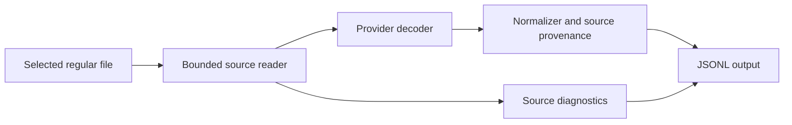

# AgentView architecture

AgentView is a Go CLI that reads an explicitly selected session file or discovers files beneath a selected session directory. It does not own or control the native agent process. Closing AgentView stops observation only.

## Observation pipeline

`cmd/agentview` parses arguments and drives inspection or polling. `internal/observe` contains the source readers, registered adapters, provider decoders, and normalized event types. The project uses the Go standard library without third-party dependencies.

Acquisition and interpretation are separate. `Reader` handles appended JSONL for Claude, Codex, and Copilot. `SnapshotReader` handles Rovo replacement documents. Each registered adapter supplies a decoder and declares its capabilities; snapshot adapters also validate candidate documents before accepting them. See the [adapter contract](adapters.md).

## Bounded source reads

Sources are regular files opened read-only. Final-component symlinks and special files are rejected. JSONL reads have an upper byte boundary per batch, a record-size limit, bounded output, and incomplete-tail handling. File identity and sampled content anchors detect common replacement, truncation, and rewrite cases; diagnostics disclose source-generation changes. They cannot detect every arbitrary edit or recover records removed before observation.

Snapshots are bounded complete JSON documents. A changed valid document produces a revision boundary and a projection of the current contents. Identical bytes are suppressed; invalid replacements retain the last accepted revision. Projection covers the first 254 parts, including ignored parts, so long histories can omit their newest messages. Snapshot revisions are observations, not incremental execution events.

`inspect` stops at its initial read boundary. `follow` polls and retries a source that becomes unavailable after initial attachment. Cancellation affects only AgentView-owned resources; an output stall has a bounded shutdown fallback that can leave a partial final line. See the [README](../README.md) for limits and exit codes.

## Identity and interpretation

The normalizer adds adapter version, source position, observation time, capture mode, scoped session identity, and occurrence identity. Native event time is separate from observation time. A source path identifies an attachment, not a canonical session. Snapshot indices are revision-local; JSONL positions are byte offsets.

Execution state stays unknown because persisted records do not establish process liveness or task success. Tool requests, recorded results, and provider-reported outcomes retain their distinct meanings. Parent message IDs do not automatically establish a subagent tree. The timeline follows physical source order and does not reconstruct every branch or compaction.

## Content and persistence

Default output omits prompts, responses, tool arguments, and tool results. `--include-content` enables supported user-facing content; recognized reasoning payloads remain excluded. Content opt-in is not redaction. Metadata can still include sensitive paths and identifiers.

AgentView does not modify source files, follow instructions embedded in records, or open additional files named inside records. It has no persistent database, external search service, or process-control API. A loopback web server serves the embedded dashboard and authenticated read-only APIs. Redirected output is a caller-managed copy.

## Directory coordination

`Directory` recursively inventories a selected Claude/Codex root and reconciles it on the polling interval. A bounded paged traversal registers independent reader/normalizer pairs. Each scheduling round processes at most one bounded batch per eligible source, so a large backfill does not drain before another source gets a turn. Changed source identity, size, or modification time schedules a read; failed sources retry on later scans.

Initial byte boundaries are captured when each source is opened during discovery. New-activity mode decodes historical records for context while suppressing their output. Incomplete tails are reread from their record start rather than retained per idle source. No filesystem notification dependency, persistent registry, or checkpoint store is introduced. See the [directory guide](directory-observation.md) for coverage limits and phase semantics.

The CLI selects compact text for terminal output and JSONL for redirected output. Text summarizes startup and repeated unsupported types; the explicit JSONL format preserves all normalized events.

## Browser dashboard

`internal/dashboard` contains a mutex-protected source registry, bounded live event retention, provider-aware metrics, and a loopback HTTP server. Each configured root has an independent directory observer. Startup history is indexed for identity, relationships, and counters but excluded from the live event buffer. Browser polling runs every second; watch polling is separately configurable.

Inventory responses contain small metric summaries. The selected-session endpoint returns detailed tool statistics and up to 120 retained live events, subject to a 2,000-event global budget. Content is clipped to 8 KiB per displayed event. History inspection uses an independent, cancellable reader with a first-open boundary, a 64 MiB total read budget, and the most recent 200 projected events within that prefix. At most two history requests run concurrently. None of these operations changes a follow cursor.

The server binds only to an explicit loopback IP. A cryptographically random per-launch token travels in the initial URL fragment, is removed from the address bar, and is sent in Authorization headers for API requests. Host and Origin validation reject unrelated websites; CSP forbids remote scripts and framing. Transcript content is rendered with DOM text nodes, never HTML. There are no mutation endpoints, telemetry uploads, or remote assets.

Model/effort and relationship metadata remain distinct from process state. Codex usage snapshots replace earlier cumulative values; Claude usage is accumulated by native message ID with replacement on repeated message snapshots. Token semantics stay provider-specific, and no cross-source billing total is computed. Recorded tool IDs correlate calls/results; timestamp gaps are not claimed as pure execution latency. Detailed limitations are in the [dashboard guide](dashboard.md).
