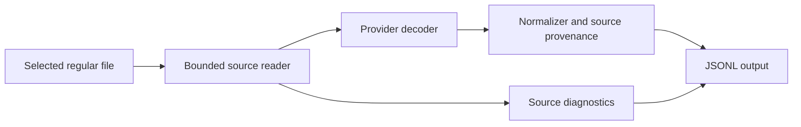

# AgentView architecture

AgentView is a Go CLI that reads an explicitly selected session file. It does not own or control the native agent process. Closing AgentView stops observation only.

## Observation pipeline

`cmd/agentview` parses arguments and drives inspection or polling. `internal/observe` contains the source readers, registered adapters, provider decoders, and normalized event types. The project uses the Go standard library without third-party dependencies.

Acquisition and interpretation are separate. `Reader` handles appended JSONL for Claude, Codex, and Copilot. `SnapshotReader` handles Rovo replacement documents. Each registered adapter supplies a decoder and declares its capabilities; snapshot adapters also validate candidate documents before accepting them. See the [adapter contract](adapters.md).

## Bounded source reads

Sources are regular files opened read-only. Final-component symlinks and special files are rejected. JSONL reads have an upper byte boundary per batch, a record-size limit, bounded output, and incomplete-tail handling. File identity and sampled content anchors detect common replacement, truncation, and rewrite cases; diagnostics disclose source-generation changes. They cannot detect every arbitrary edit or recover records removed before observation.

Snapshots are bounded complete JSON documents. A changed valid document produces a revision boundary and a projection of the current contents. Identical bytes are suppressed; invalid replacements retain the last accepted revision. Projection covers the first 254 parts, including ignored parts, so long histories can omit their newest messages. Snapshot revisions are observations, not incremental execution events.

`inspect` stops at its initial read boundary. `follow` polls and retries a source that becomes unavailable after initial attachment. Cancellation affects only AgentView-owned resources; an output stall has a bounded shutdown fallback that can leave a partial final line. See the [README](../README.md) for limits and exit codes.

## Identity and interpretation

The normalizer adds adapter version, source position, observation time, capture mode, scoped session identity, and occurrence identity. Native event time is separate from observation time. A source path identifies an attachment, not a canonical session. Snapshot indices are revision-local; JSONL positions are byte offsets.

Execution state stays unknown because persisted records do not establish process liveness or task success. Tool requests, recorded results, and provider-reported outcomes retain their distinct meanings. Parent message IDs do not automatically establish a subagent tree. The timeline follows physical source order and does not reconstruct every branch or compaction.

## Content and persistence

Default output omits prompts, responses, tool arguments, and tool results. `--include-content` enables supported user-facing content; recognized reasoning payloads remain excluded. Content opt-in is not redaction. Metadata can still include sensitive paths and identifiers.

AgentView does not modify source files, follow instructions embedded in records, or open additional files named inside records. It currently has no persistent database, automatic discovery, search service, web server, or process-control API. Redirected output is a caller-managed copy.
